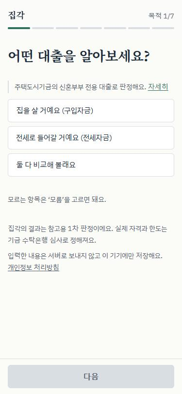
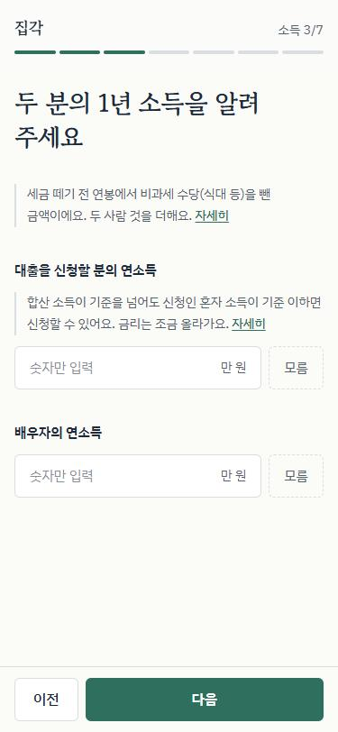
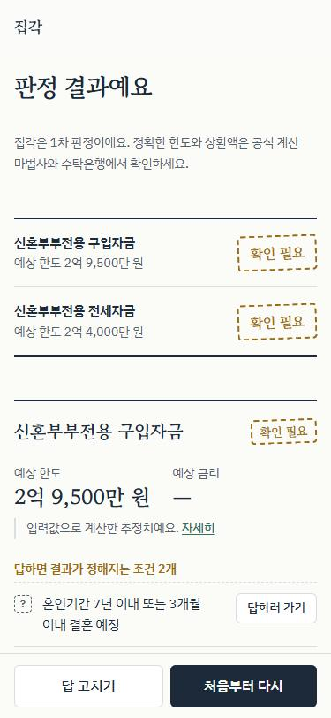
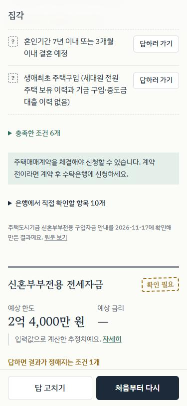

# 집각 (jipgak)

> **집 살 각 나오나?** 자녀 없는 20~30대 신혼·예비부부가 주택도시기금 신혼부부 전용 **구입자금·전세자금 대출**을 받을 수 있는지, **얼마나** 받을 수 있는지, **왜 그런지**까지 알려 주는 1차 판정 웹 서비스입니다.

| 시작 | 질문 | 판정 결과 | 판정 근거 |
|---|---|---|---|
|  |  |  |  |

## 왜 만들었나

신혼부부 전용 정책 대출은 소득, 자산, 주택 보유 이력, 집 가격과 크기, 혼인 기간까지 조건이 많고 복잡해서, 공고문을 읽어도 **"그래서 우리는 받을 수 있나?"** 를 알기 어렵습니다.

집각은 몇 가지 질문에 답하면 대출 가능 여부와 예상 한도를 바로 보여 주고, 각 조건을 왜 통과했는지·못했는지와 공식 출처를 함께 설명합니다. 결과를 보고 **무엇을 더 준비해야 하는지** 알 수 있게 하는 것이 목표입니다.

## 주요 기능

- **7단계 질문** — 대출 목적, 혼인 여부, 소득, 자산, 주택·대출 이력, 살 집과 전세 집 정보를 차례로 묻습니다. 모르는 항목은 '모름'으로 넘어갈 수 있습니다.
- **구입자금·전세자금 한 번에 비교** — 두 상품의 예상 한도를 나란히 보여 줍니다.
- **판정 근거와 출처** — 조건별로 충족·미충족·확인 필요를 나눠 보여 주고, 공식 안내 원문 링크와 기준 확인일을 표시합니다.
- **다음에 할 일** — 은행에서 직접 확인할 항목과 신청 절차(계약 → 기한 → 수탁은행 → 제출 서류)를 안내합니다.
- **개인정보를 보내지 않음** — 판정은 기기 안에서만 합니다. 입력한 소득·자산 정보는 서버로 보내지 않고 이 기기에만 저장합니다.

## 어떻게 만들었나

- **AI 바이브코딩** — 기획, 규칙 정리, 구현, 리뷰까지 AI 코딩 도구(Claude Code)와 함께 혼자 만들고 있습니다.
- **규칙은 데이터로** — 대출 조건을 코드가 아니라 JSON 규칙으로 분리했습니다. 정책이 바뀌면 규칙 데이터만 고치면 되고, 판정 엔진은 그대로 둡니다.
- **공식 기준으로 검증** — 실제 사례를 골든 케이스로 만들어 테스트하고, 공식 계산 결과와 대조해 차이를 찾아 고쳤습니다.
- **결정은 기록으로** — 왜 그렇게 만들었는지를 [결정 기록](docs/DECISIONS.md)에 남깁니다.

## 기술 스택

| 영역 | 사용 기술 |
|---|---|
| 화면 | React 19, TypeScript, Vite |
| 판정 엔진·규칙 | TypeScript 패키지(`packages/rules-engine`), JSON 규칙과 스키마(`packages/rules-data`) |
| 테스트·품질 | Vitest, ESLint, Prettier, GitHub Actions CI |
| 구성 | pnpm 모노레포 |
| 개발 방식 | AI 바이브코딩(Claude Code) |

## 저장소 구조

```
apps/mobile-web/        화면 (React + Vite)
packages/rules-engine/  판정 엔진
packages/rules-data/    대출 규칙(JSON)과 스키마
docs/                   기획·아키텍처·결정 기록·규칙 출처
```

## 실행 방법

필요한 것: Node.js 22, pnpm

```bash
pnpm install
pnpm --filter @jipgak/mobile-web dev   # → http://localhost:5173
pnpm test                              # 전체 테스트
```

## 문서

- [기획안](docs/PLAN.md) · [아키텍처](docs/ARCHITECTURE.md) · [결정 기록](docs/DECISIONS.md) · [진행 상황](docs/STATUS.md)
- [규칙 출처](docs/sources/README.md) · [골든 케이스](docs/golden-cases.md) · [테스트 한눈에 보기](docs/TEST-CASES.md) · [용어집](docs/GLOSSARY.md)

## 알려 드립니다

집각의 결과는 참고용 1차 판정입니다. 실제 자격과 한도는 주택도시기금 수탁은행 심사로 정해지며, 최신 기준은 공식 안내 원문을 확인하세요.
